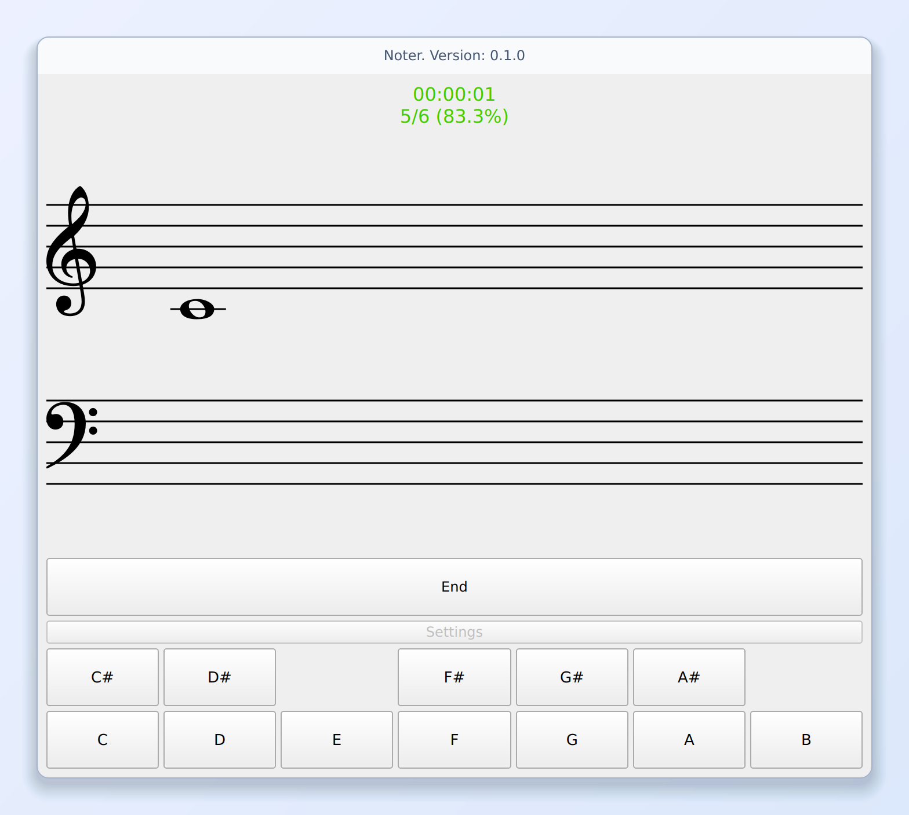
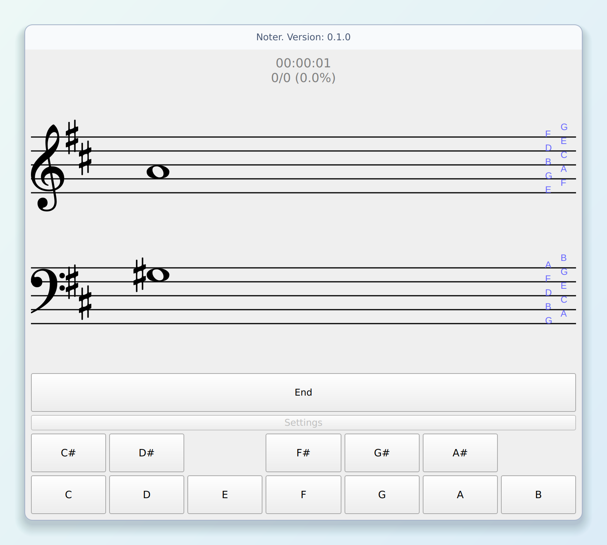
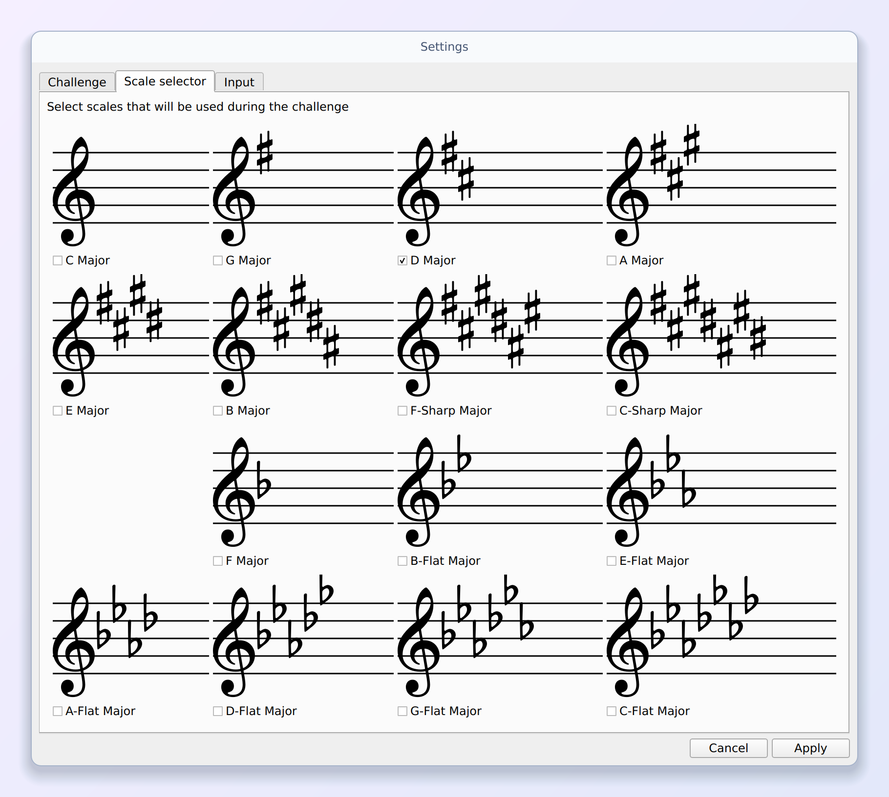

# Noter

Noter is a Python desktop app for learning to read music in treble and bass clefs. Click **Start**, then identify each note using the on-screen keys. The timer and score track your practice, and **Settings** lets you choose major key signatures and show note-name hints.

## Run locally

```sh
python3 -m venv .venv
source .venv/bin/activate
python -m pip install -r requirements.txt
python main.py
```

## Screenshots



| Note-name hints | Major key signatures |
| --- | --- |
|  |  |

## License

[MIT](LICENSE)
